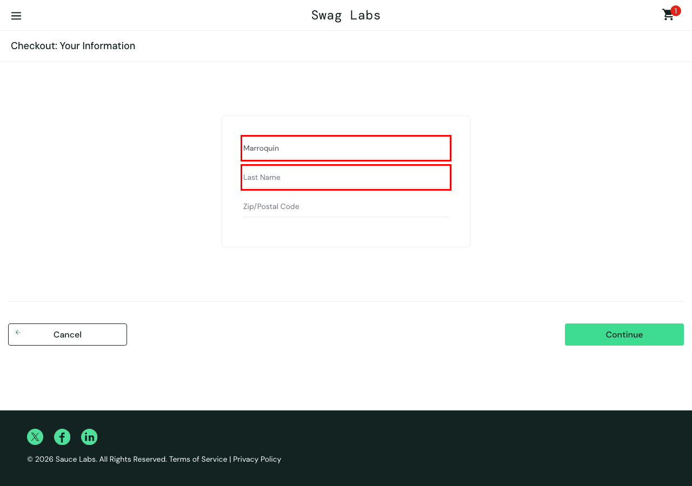

# QA manual · SauceDemo

Portfolio de **testing manual** sobre [SauceDemo](https://www.saucedemo.com), una tienda de demo pública. Muestra cómo planifico, diseño casos, exploro y reporto bugs.

| Documento | Qué contiene |
| --- | --- |
| [Plan de pruebas](plan-de-pruebas.md) | Objetivo, alcance, usuarios, enfoque, criterios y resultado |
| [Casos de prueba](casos/casos-de-prueba.md) | 24 casos con pasos y resultado esperado ([CSV](casos/casos-de-prueba.csv) para Jira o TestRail) |
| [Sesiones exploratorias](exploratorio.md) | 3 sesiones con objetivo, tiempo y hallazgos |
| [Bugs](bugs/) | 6 reportes con pasos, esperado vs. actual, severidad y captura |

## Resultado

**24 casos ejecutados · 18 pasaron · 6 fallaron · 6 bugs reportados.**

| Bug | Título | Usuario | Severidad |
| --- | --- | --- | --- |
| [BUG-01](bugs/BUG-01.md) | Todos los productos muestran la misma imagen | `problem_user` | Media |
| [BUG-02](bugs/BUG-02.md) | Ordenar por precio no ordena los productos | `problem_user` | Alta |
| [BUG-03](bugs/BUG-03.md) | Algunos productos no se agregan al carrito | `problem_user` | Crítica |
| [BUG-04](bugs/BUG-04.md) | Escribir el apellido pisa el nombre en el checkout | `problem_user` | Crítica |
| [BUG-05](bugs/BUG-05.md) | El botón Finish no termina la compra | `error_user` | Crítica |
| [BUG-06](bugs/BUG-06.md) | Los precios del catálogo no coinciden con los reales | `visual_user` | Alta |

## Proyectos relacionados

- [playwright-ai-e2e](https://github.com/Ederma/playwright-ai-e2e): los casos críticos y los 6 bugs automatizados con Playwright, con ayuda de agentes de IA.
- [api-testing-restful-booker](https://github.com/Ederma/api-testing-restful-booker): pruebas de API con Postman y Newman.

---

Eder Marroquín · QA Analyst · [LinkedIn](https://www.linkedin.com/in/eder-marroquin-bb04298a/)
