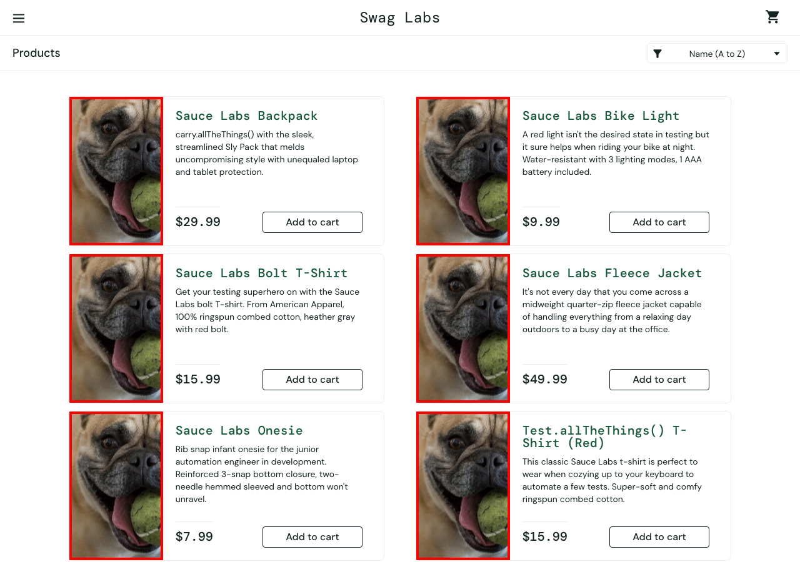

# BUG-01 · Todos los productos muestran la misma imagen

| Campo | Valor |
| --- | --- |
| Severidad | Media |
| Prioridad | Alta |
| Usuario | `problem_user` |
| Entorno | Chrome · macOS · 1280×900 · https://www.saucedemo.com |
| Caso de prueba | TC-08 |
| Test automatizado | [`known-bugs.spec.ts`](https://github.com/Ederma/playwright-ai-e2e/blob/main/tests/known-bugs.spec.ts) |
| Estado | Abierto |

## Pasos para reproducir

1. Iniciar sesión con `problem_user` / `secret_sauce`.
2. Mirar las imágenes del catálogo.

## Resultado esperado

Cada producto muestra su propia foto, como con `standard_user`.

## Resultado actual

Los 6 productos muestran la misma imagen (un perro), sin relación con el producto.

## Impacto

El cliente no puede identificar qué está comprando por la imagen.

## Evidencia

