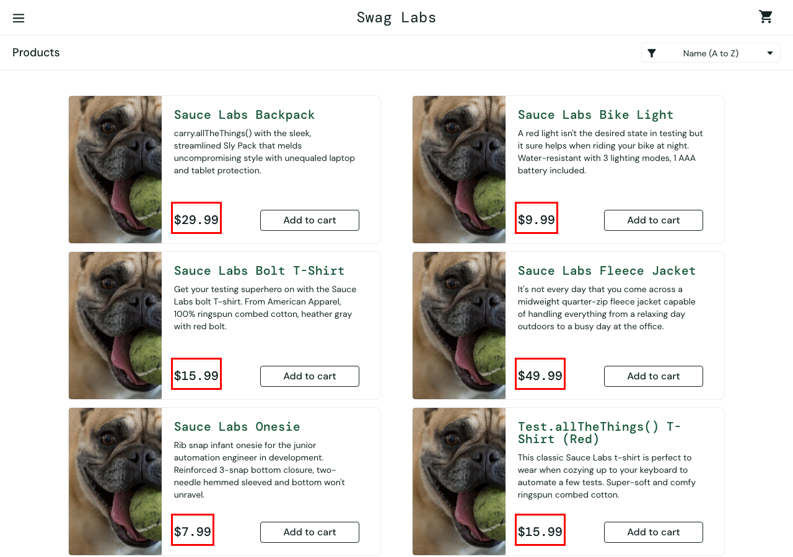

# BUG-02 · Ordenar por precio no ordena los productos

| Campo | Valor |
| --- | --- |
| Severidad | Alta |
| Prioridad | Media |
| Usuario | `problem_user` |
| Entorno | Chrome · macOS · 1280×900 · https://www.saucedemo.com |
| Caso de prueba | TC-11 |
| Test automatizado | [`known-bugs.spec.ts`](https://github.com/Ederma/playwright-ai-e2e/blob/main/tests/known-bugs.spec.ts) |
| Estado | Abierto |

## Pasos para reproducir

1. Iniciar sesión con `problem_user`.
2. En el selector de orden elegir **Price (low to high)**.

## Resultado esperado

Los productos quedan ordenados de menor a mayor precio: $7.99, $9.99, $15.99, $15.99, $29.99, $49.99.

## Resultado actual

El orden no cambia: $29.99, $9.99, $15.99, $49.99, $7.99, $15.99.

## Impacto

El cliente que busca lo más barato ve un orden falso.

## Evidencia

