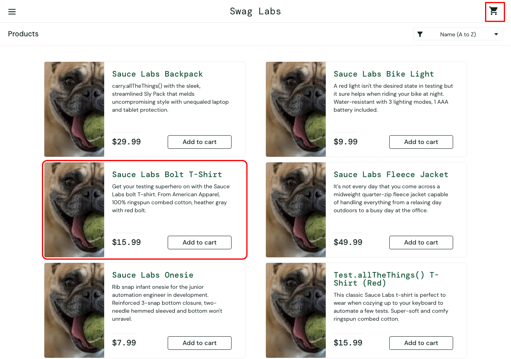

# BUG-03 · Algunos productos no se agregan al carrito

| Campo | Valor |
| --- | --- |
| Severidad | Crítica |
| Prioridad | Alta |
| Usuario | `problem_user` |
| Entorno | Chrome · macOS · 1280×900 · https://www.saucedemo.com |
| Caso de prueba | TC-15 |
| Test automatizado | [`known-bugs.spec.ts`](https://github.com/Ederma/playwright-ai-e2e/blob/main/tests/known-bugs.spec.ts) |
| Estado | Abierto |

## Pasos para reproducir

1. Iniciar sesión con `problem_user`.
2. Clic en **Add to cart** de *Sauce Labs Bolt T-Shirt*.

## Resultado esperado

El botón cambia a **Remove** y el contador del carrito muestra 1.

## Resultado actual

El botón no cambia y el carrito sigue vacío. Pasa también con *Sauce Labs Fleece Jacket* y *Test.allTheThings() T-Shirt (Red)*; los otros 3 productos sí se agregan.

## Impacto

La mitad del catálogo no se puede comprar.

## Evidencia

