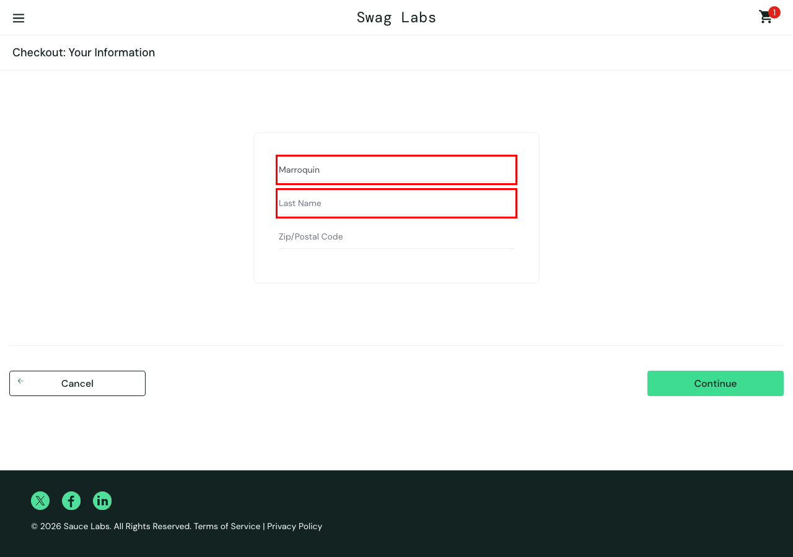

# BUG-04 · Escribir el apellido pisa el nombre en el checkout

| Campo | Valor |
| --- | --- |
| Severidad | Crítica |
| Prioridad | Alta |
| Usuario | `problem_user` |
| Entorno | Chrome · macOS · 1280×900 · https://www.saucedemo.com |
| Caso de prueba | TC-19 |
| Test automatizado | [`known-bugs.spec.ts`](https://github.com/Ederma/playwright-ai-e2e/blob/main/tests/known-bugs.spec.ts) |
| Estado | Abierto |

## Pasos para reproducir

1. Iniciar sesión con `problem_user` y agregar *Sauce Labs Backpack*.
2. Ir al carrito → **Checkout**.
3. Escribir `Eder` en First Name y `Marroquin` en Last Name.

## Resultado esperado

First Name = Eder y Last Name = Marroquin.

## Resultado actual

Lo que se escribe en Last Name aparece en First Name (queda `Marroquin`) y Last Name queda vacío. Al continuar sale *Error: Last Name is required*.

## Impacto

La compra no se puede completar.

## Evidencia

