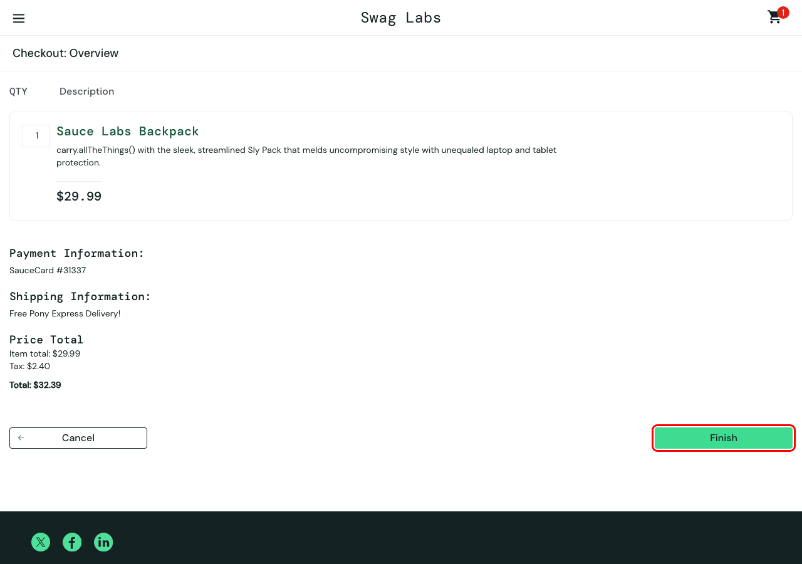

# BUG-05 · El botón Finish no termina la compra

| Campo | Valor |
| --- | --- |
| Severidad | Crítica |
| Prioridad | Alta |
| Usuario | `error_user` |
| Entorno | Chrome · macOS · 1280×900 · https://www.saucedemo.com |
| Caso de prueba | TC-23 |
| Test automatizado | [`known-bugs.spec.ts`](https://github.com/Ederma/playwright-ai-e2e/blob/main/tests/known-bugs.spec.ts) |
| Estado | Abierto |

## Pasos para reproducir

1. Iniciar sesión con `error_user` y agregar *Sauce Labs Backpack*.
2. Checkout → completar nombre, apellido y código postal → **Continue**.
3. Clic en **Finish**.

## Resultado esperado

Se muestra *Thank you for your order!*.

## Resultado actual

La página se queda en el resumen (checkout-step-two) sin mensaje ni error visible. Además, el campo Last Name no acepta texto (mismo síntoma que BUG-04, sin pisar el nombre).

## Impacto

El cliente no sabe si compró o no.

## Evidencia

