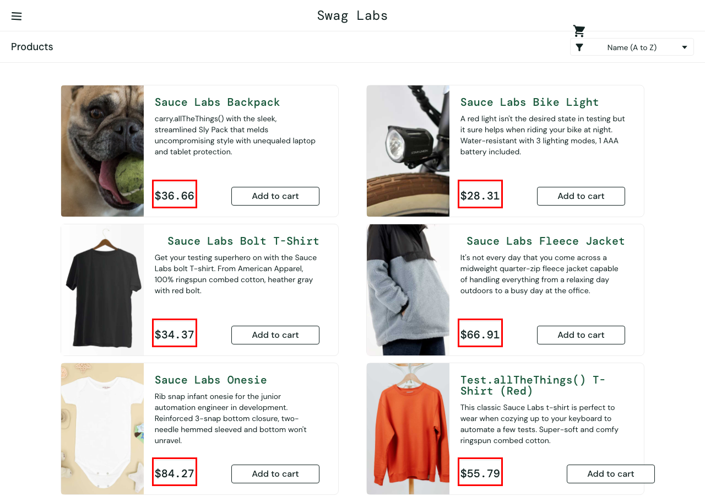
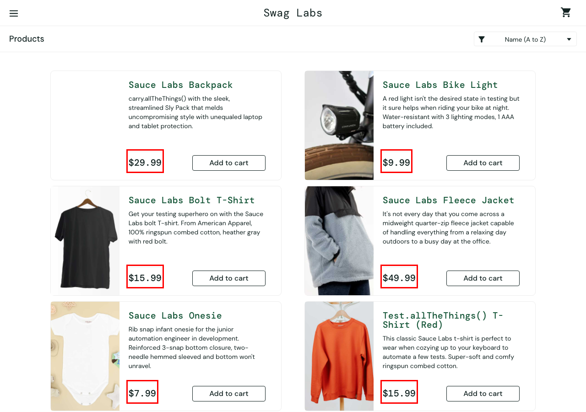

# BUG-06 · Los precios del catálogo no coinciden con los reales

| Campo | Valor |
| --- | --- |
| Severidad | Alta |
| Prioridad | Media |
| Usuario | `visual_user` |
| Entorno | Chrome · macOS · 1280×900 · https://www.saucedemo.com |
| Caso de prueba | TC-12 |
| Test automatizado | [`known-bugs.spec.ts`](https://github.com/Ederma/playwright-ai-e2e/blob/main/tests/known-bugs.spec.ts) |
| Estado | Abierto |

## Pasos para reproducir

1. Iniciar sesión con `standard_user` y anotar los precios.
2. Cerrar sesión e iniciar con `visual_user`.
3. Comparar los precios del catálogo.

## Resultado esperado

Los mismos precios que con `standard_user` ($29.99, $9.99, $15.99, $49.99, $7.99, $15.99).

## Resultado actual

Los precios cambian en cada carga y no coinciden con los reales (por ejemplo $49.1 o $13.51).

## Impacto

El cliente ve un precio distinto del que va a pagar.

## Evidencia

